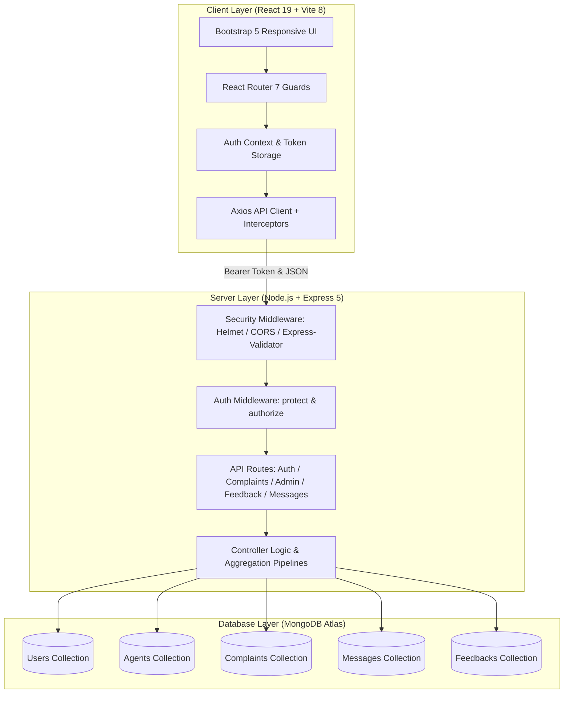
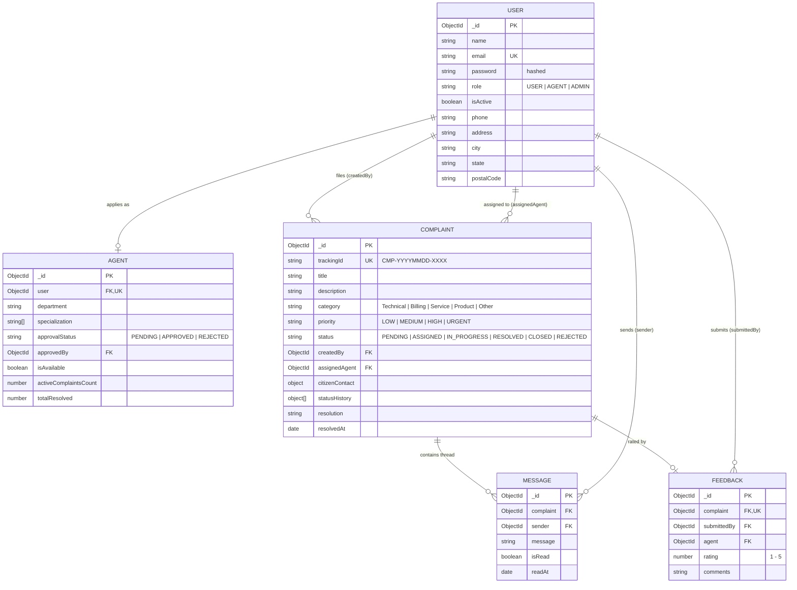
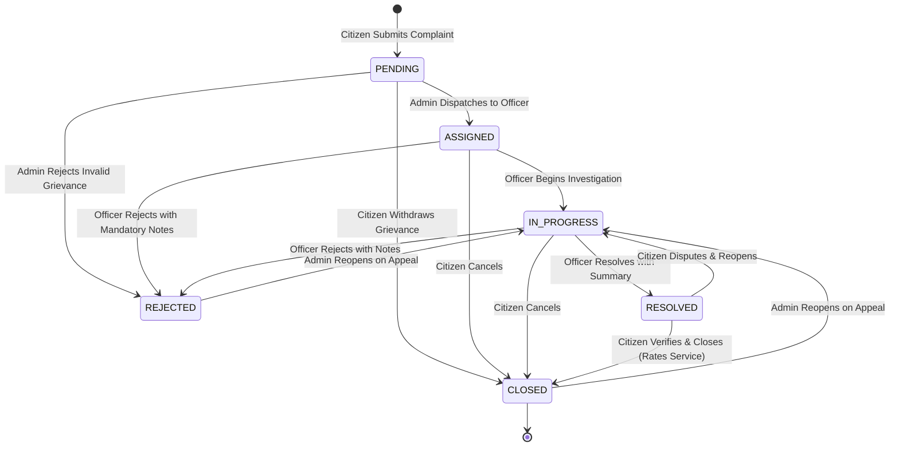

# CivicResolve — SkillWallet SmartBridge Internship Submission Portfolio

**Program:** Full-Stack Web Development (MERN) Internship
**Partner:** SkillWallet SmartBridge
**Project:** CivicResolve — Online Complaint Registration & Municipal Grievance Resolution Portal
**Repository Path:** `c:\Users\rahul\online-complaint-registration`

---

## 1. Executive Summary & Problem Statement

Urban and municipal grievance redressal systems frequently suffer from lack of transparency, manual tracking inefficiencies, missing communication channels between citizens and investigation officers, and absent accountability metrics.

**CivicResolve** is a production-grade, full-stack municipal grievance redressal web application built on the **MERN** stack (MongoDB Atlas, Express 5, React 19, Node.js 22). It establishes:
- **Citizen Portal:** Self-registration, multi-category grievance submission, automatic human-readable tracking ID generation (`CMP-YYYYMMDD-XXXX`), timeline audit trails, inquiry messaging, and satisfaction ratings.
- **Officer Duty Console:** Department-scoped grievance queues, multi-state transition workflows (`IN_PROGRESS`, `RESOLVED`, `REJECTED`) with required resolution summaries, and citizen messaging threads.
- **Administrative Center:** Real-time MongoDB aggregation analytics (status, category, priority distributions, resolution velocity, officer workloads), grievance dispatch, officer application approval/rejection workflows, and user account access control.

---

## 2. Technology Stack Breakdown

| Technology Layer | Framework / Library | Version | Engineering Role |
| :--- | :--- | :--- | :--- |
| **Frontend Framework** | React | 19.3.1 | Component-based reactive user interface |
| **Bundler & Build Tool**| Vite | 8.3.4 | ESM-based fast development and production build pipeline |
| **Routing** | React Router DOM | 7.18.4 | Declarative client-side routing with role-based guards |
| **Styling & Icons** | Bootstrap & Bootstrap Icons | 5.3.8 | Responsive grid, accessible forms, modal dialogs |
| **Client HTTP Client** | Axios | 1.20.0 | Interceptor-driven Bearer token authentication & error handling |
| **Notifications** | React Toastify | 11.1.0 | Real-time user feedback alerts |
| **Backend Framework** | Express | 5.3.0 | RESTful API routing, middleware chaining, JSON serialization |
| **Runtime Environment**| Node.js | 20+ / 22+ | CommonJS server architecture |
| **Database & ODM** | MongoDB Atlas & Mongoose | 9.11.3 | Document database with schemas, validation, indexing |
| **Security & Auth** | JWT & BcryptJS | 9.0.3 / 3.0.3 | Token-based stateless authentication & password hashing |
| **Validation** | Express-Validator | 7.3.2 | Strict request sanitization and payload constraint enforcement |
| **Security Headers** | Helmet & CORS | 8.3.0 / 2.8.6 | HTTP response header hardening & cross-origin origin protection |
| **Test Runner** | Node.js Native Test Runner | Native | 70 automated test cases (`node:test`, `node:assert/strict`) |

---

## 3. High-Level System Architecture



---

## 4. Entity-Relationship Model (Mongoose Schemas)



---

## 5. Complaint Resolution Lifecycle State Machine



---

## 6. REST API Endpoint Catalog

### Authentication & Profile (`/api/auth`)
- `POST /api/auth/register`: Citizen registration (strictly enforced `role: "USER"`).
- `POST /api/auth/login`: Credential validation, JWT issuance.
- `GET /api/auth/me`: Session inspection & role verification.
- `PATCH /api/auth/me`: Profile contact information update.

### Complaints Lifecycle (`/api/complaints`)
- `POST /api/complaints`: Register new grievance (Citizen only, generates tracking ID).
- `GET /api/complaints`: Paginated listing with filtering by status, category, priority, and date (role-scoped).
- `GET /api/complaints/:id`: Detailed view by Mongo ID with timeline history.
- `GET /api/complaints/track/:trackingId`: Public lookup by human-readable tracking ID.
- `PATCH /api/complaints/:id/status`: Status transition enforcement (Officer resolution notes / Citizen close).
- `PATCH /api/complaints/:id/assign`: Administrative officer dispatch (Admin only).

### Inquiry Messaging (`/api/complaints/:complaintId/messages`)
- `POST /api/complaints/:complaintId/messages`: Post message in complaint thread.
- `GET /api/complaints/:complaintId/messages`: Retrieve chronological thread messages.
- `PATCH /api/complaints/:complaintId/messages/:messageId/read`: Mark message as read.

### Citizen Feedback (`/api/feedback`)
- `POST /api/feedback`: Submit 1–5 star rating and comment on completed grievance (Citizen only).
- `GET /api/feedback/complaint/:complaintId`: Retrieve feedback for specific complaint.
- `GET /api/feedback`: Retrieve role-scoped feedback list.

### Administration & Analytics (`/api/admin`)
- `GET /api/admin/analytics/overview`: Live MongoDB aggregation metrics (status, category, priority, avg hours).
- `GET /api/admin/agents`: Officer application queue with pagination and status filters.
- `PATCH /api/admin/agents/:id/approve`: Approve officer application & promote user to `AGENT` role.
- `PATCH /api/admin/agents/:id/reject`: Reject application with mandatory review notes.
- `GET /api/admin/users`: User account list with search and pagination.
- `PATCH /api/admin/users/:id/status`: Activate or deactivate user access.

---

## 7. Automated Test Suite & Quality Assurance

The backend includes 6 test suites covering 70 test cases executed via Node.js native test runner:

```bash
cd server
npm test
```

| Test Suite | File | Test Cases | Areas Covered |
| :--- | :--- | :---: | :--- |
| **Authentication** | `tests/auth.test.js` | 13 | Registration, bcrypt hashing, JWT issuance, profile updates |
| **Mongoose Models** | `tests/models.test.js` | 11 | Schema constraints, enums, tracking ID generation, unique indexes |
| **Complaints Lifecycle**| `tests/complaint.test.js` | 15 | Status machine, assignment, transition notes, role scoping |
| **Messaging & Feedback**| `tests/messaging_feedback.test.js`| 12 | Conversation threading, unread status, 1-5 star ratings |
| **Admin Analytics** | `tests/admin_analytics.test.js` | 10 | Aggregation pipelines, application approval, account revocation |
| **Security & Hardening**| `tests/security_e2e_hardening.test.js`| 9 | Mass-assignment defense, expired token rejection, input sanitization |
| **Total** | | **70** | **100% Pass Rate** |

---

## 8. Evaluator Demo Guide (Isolated Test Database)

To evaluate the live application without touching any production database:

### Safe Evaluator Credentials
- **Administrator:** `demo.admin@civicresolve.demo` | Password: `DemoAdmin2026!`
- **Officer (Technical):** `officer.tech@civicresolve.demo` | Password: `DemoOfficer2026!`
- **Officer (Billing):** `officer.billing@civicresolve.demo` | Password: `DemoOfficer2026!`
- **Citizen (Jane):** `citizen.jane@civicresolve.demo` | Password: `DemoCitizen2026!`
- **Citizen (John):** `citizen.john@civicresolve.demo` | Password: `DemoCitizen2026!`

*(Note: These credentials are strictly designated demo credentials for the isolated `civicresolve_demo` database namespace).*

### 3-Step Evaluator Launch
```powershell
# 1. Seed the isolated demo database:
cd server
$env:ALLOW_DEMO_SEED = "true"
$env:DEMO_MONGODB_URI = "mongodb+srv://<user>:<password>@<cluster>/civicresolve_demo?retryWrites=true&w=majority"
npm run seed:demo

# 2. Run backend against demo database:
$env:MONGODB_URI = $env:DEMO_MONGODB_URI
npm start

# 3. In second terminal, launch frontend:
cd ..\client
npm run dev
```
Open **`http://localhost:5173/login`** in your browser.
